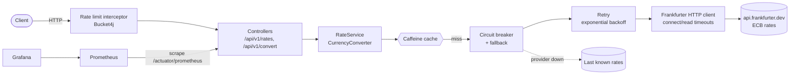

# FX Rate Service

[](https://github.com/Adri23Ausin/fx-rate-service/actions/workflows/ci.yml)


Exchange rate and currency conversion API built on the European Central Bank reference rates. It is designed to **keep answering when its upstream provider does not**: responses are cached, transient failures are retried, a circuit breaker stops hammering a provider that is down, and the last known rates are served (flagged as `stale`) as a fallback. Every client is rate limited, and the whole thing is observable through Prometheus and a provisioned Grafana dashboard.

### Author: Adrián Ausín Cuesta

## Contents

1. [Features](#features)
2. [Tech stack](#tech-stack)
3. [Architecture](#architecture)
4. [Run it](#run-it)
5. [API](#api)
6. [Observability](#observability)
7. [Tests](#tests)
8. [Design decisions](#design-decisions)
9. [Possible improvements](#possible-improvements)

## Features

- **Latest and historical rates** for ~30 currencies since 1999, optionally filtered by symbol.
- **Currency conversion** using `BigDecimal`, rounded to the minor unit of the target currency (2 decimals for EUR, 0 for JPY, 3 for KWD) with banker's rounding.
- **Two-level caching** with Caffeine: latest rates for 10 minutes, historical rates (immutable) for 24 hours since last access.
- **Resilience** with Resilience4j: retry with exponential backoff, circuit breaker, timeouts and a last-known-rates fallback.
- **Rate limiting** per API key or IP with Bucket4j token buckets, `X-Rate-Limit-*` headers and `429` + `Retry-After`.
- **Errors as RFC 9457 problem details**, mapped exhaustively from a sealed exception hierarchy.
- **Observability**: Actuator health (including circuit breaker state), Prometheus metrics, business counters and a ready-made Grafana dashboard.
- **OpenAPI 3.1** documentation with Swagger UI.

## Tech stack

| Area | Technology |
|---|---|
| Language | Java 21 (records, sealed classes, pattern matching for `switch`, virtual threads) |
| Framework | Spring Boot 4.1, Spring MVC, declarative HTTP interface on `RestClient` |
| Resilience | Resilience4j 2.4 (circuit breaker, retry) |
| Caching | Spring Cache + Caffeine |
| Rate limiting | Bucket4j 8 |
| Observability | Micrometer, Spring Boot Actuator, Prometheus, Grafana |
| API docs | springdoc-openapi 3 |
| Tests | JUnit 5, AssertJ, Mockito, `MockMvcTester`, WireMock |
| Build & delivery | Maven wrapper, multi-stage Docker image, Docker Compose, GitHub Actions |

## Architecture



The provider call is wrapped, from the outside in, by **cache → circuit breaker (with fallback) → retry → HTTP call**:

- A cache hit never reaches the circuit breaker, so cached traffic doesn't hide or distort provider health.
- The circuit breaker sees one call per *exhausted* retry sequence, so a single blip that the retry absorbs is not counted as a failure.
- Stale fallback results are never cached (`unless = "#result.stale"`), so the service goes back to fresh data as soon as the provider recovers.

```
src/main/java/com/adrianausin/fxrate
├── rates/                  # Domain: snapshots, conversion, validation, sealed exceptions
├── provider/frankfurter/   # HTTP client, resilient provider, last-known-rates store
├── ratelimit/              # Bucket4j interceptor
├── web/                    # REST controllers and problem-detail mapping
└── config/                 # Cache, metrics and OpenAPI configuration
```

## Run it

Requires **JDK 21**, or just **Docker**. Port 8080 must be free.

### Locally

```bash
./mvnw spring-boot:run        # macOS / Linux
.\mvnw.cmd spring-boot:run    # Windows
```

Swagger UI: http://localhost:8080/swagger-ui.html

### With Docker Compose (API + Prometheus + Grafana)

```bash
docker compose up --build
```

| Service | URL |
|---|---|
| API | http://localhost:8080 |
| Swagger UI | http://localhost:8080/swagger-ui.html |
| Prometheus | http://localhost:9090 |
| Grafana (dashboard opens as home page) | http://localhost:3000 (anonymous viewer, or `admin` / `admin`) |

## API

All endpoints live under `/api/v1`. Currency codes are case-insensitive ISO 4217 codes. [`requests.http`](requests.http) has ready-to-run examples for IntelliJ or VS Code.

| Method | Path | Description |
|---|---|---|
| `GET` | `/rates/latest?base=EUR&symbols=USD,GBP` | Latest rates for a base currency |
| `GET` | `/rates/{date}?base=EUR&symbols=USD` | Rates on a date (previous business day on weekends) |
| `GET` | `/convert?from=EUR&to=USD&amount=100[&date=2024-01-02]` | Convert an amount |

```bash
curl "localhost:8080/api/v1/convert?from=EUR&to=JPY&amount=250.50"
```

```json
{
  "from": "EUR",
  "to": "JPY",
  "amount": 250.50,
  "result": 43965,
  "rate": 175.51,
  "rateDate": "2026-10-23",
  "stale": false
}
```

When the provider is down and the last known rates are served, `stale` is `true`. Errors follow RFC 9457:

```bash
curl "localhost:8080/api/v1/rates/latest?base=ABC"
```

```json
{
  "title": "Bad Request",
  "status": 400,
  "detail": "Currency 'ABC' is not supported",
  "instance": "/api/v1/rates/latest"
}
```

| Status | When |
|---|---|
| `400` | Unknown currency, invalid amount (≤ 0 or more than 6 decimals), date before 1999-01-04 or in the future |
| `429` | Rate limit exceeded (60 requests/minute per client by default). Includes `Retry-After` |
| `503` | Provider unavailable and there are no last known rates to fall back to |

## Observability

| Endpoint | Content |
|---|---|
| `/actuator/health` | Health including the `frankfurter` circuit breaker state |
| `/actuator/prometheus` | All metrics in Prometheus format |
| `/actuator/circuitbreakers`, `/actuator/caches` | Live state of the circuit breaker and caches |

Business metrics on top of the standard HTTP, JVM, cache and Resilience4j metrics:

| Metric | Tags | Meaning |
|---|---|---|
| `fx_conversions_total` | `from`, `to` | Conversions per currency pair |
| `fx_provider_fallback_total` | `operation`, `outcome` | Calls answered by the fallback (`stale` or `unavailable`) |
| `fx_rate_limit_rejected_total` | | Requests rejected with `429` |

The Grafana dashboard (`monitoring/grafana/dashboards/fx-rate-service.json`) shows the circuit breaker state, request rate, p95 latency per endpoint, cache hit ratio, fallbacks, rate-limited requests and the most converted currency pairs.

## Tests

```bash
./mvnw verify
```

42 tests, none of which touch the real provider:

- **Unit tests**: rounding rules per currency, banker's rounding, date and currency validation.
- **Web slice tests** (`@WebMvcTest` + `MockMvcTester`): parameter validation and problem-detail responses.
- **WireMock integration tests** for the resilience behaviour: retries on 5xx, timeouts, circuit opening after repeated failures (and *not* opening on 404s), stale fallback, and stale results never being cached.
- **Caching tests**: case-insensitive cache keys, one upstream call per base and date.
- **Rate limiting and observability tests** against the full application context.

## Design decisions

- **`BigDecimal` everywhere and rounding by currency.** Money is never a `double`. The scale comes from `java.util.Currency#getDefaultFractionDigits`, so JPY gets no decimals and KWD gets three without hard-coding anything. `HALF_EVEN` avoids the upward bias of `HALF_UP` when many amounts are rounded.
- **Serve stale data instead of failing.** For exchange rates, rates from the last business day are far more useful than a 503. The response says so explicitly (`stale: true`), so clients that need fresh data can decide for themselves.
- **Only server errors and timeouts count as failures.** A 404 for an unknown currency is the client's fault: it is not retried and doesn't trip the circuit breaker, otherwise a client sending bad input could take the service down for everyone.
- **Different cache policies for different data.** Historical rates never change, so they use `expireAfterAccess` and a size bound. The latest rates use a short `expireAfterWrite`, so new ECB publications show up quickly.
- **Sealed exception hierarchy.** `FxRateException` permits exactly three subtypes, and the exception handler uses an exhaustive `switch`. Adding a new error type without mapping it to an HTTP status is a compile error.
- **Virtual threads.** The service mostly waits on I/O to the provider, so `spring.threads.virtual.enabled=true` lets it handle many concurrent requests without tuning a thread pool.

## Possible improvements

- Move rate limit buckets and the cache to Redis so limits and data are shared across replicas.
- Add a second rate provider and fail over between them.
- Refresh the latest rates proactively right after the ECB publication time (~16:00 CET) instead of waiting for the cache to expire.
- Add authentication for API keys instead of treating them as plain identifiers.
- Add distributed tracing with OpenTelemetry.

## License

[MIT](LICENSE)
